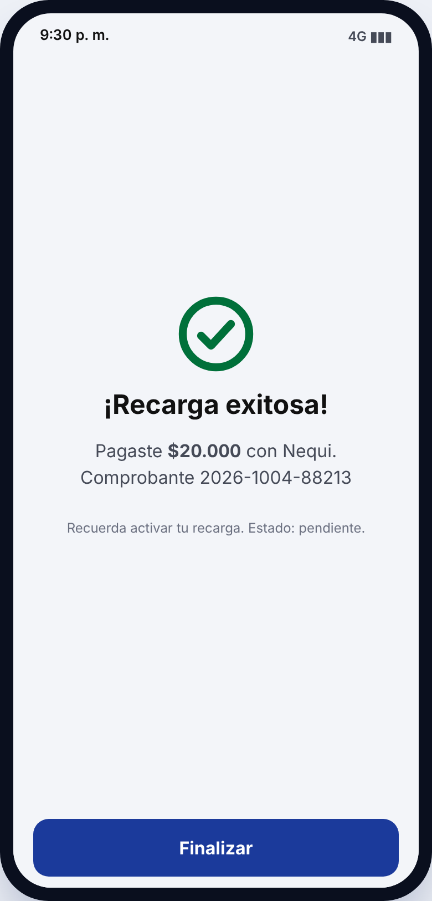
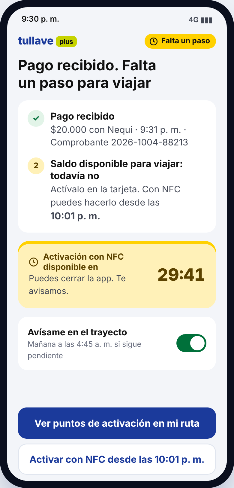
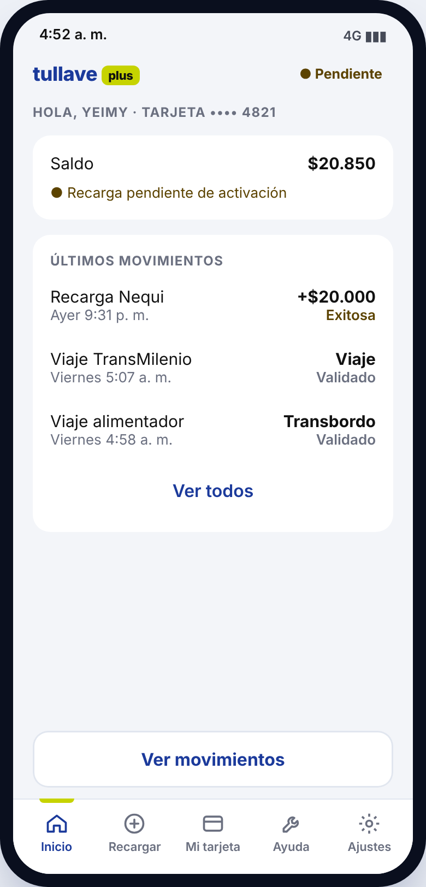
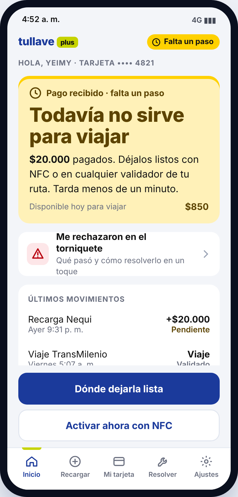
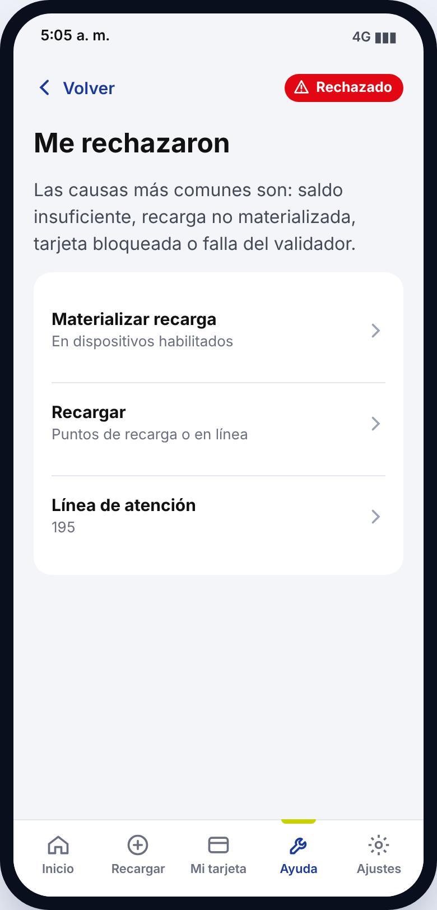
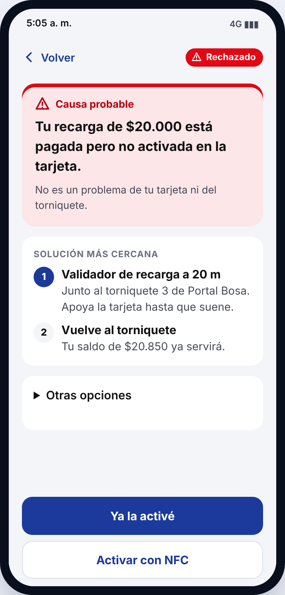
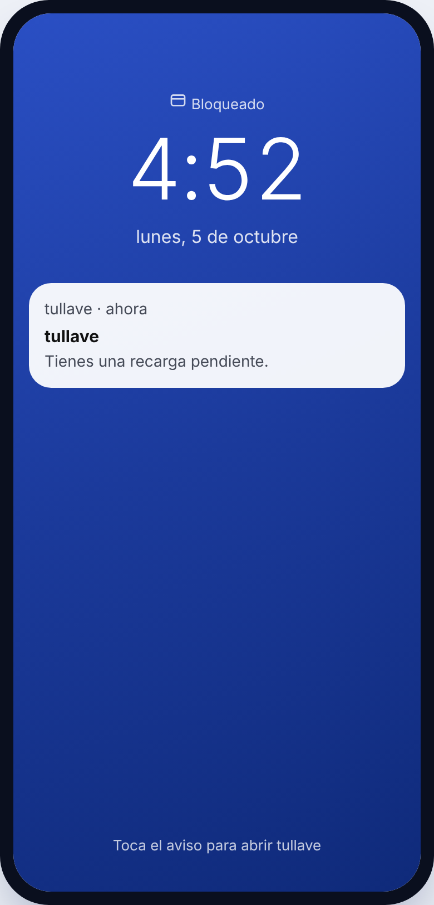
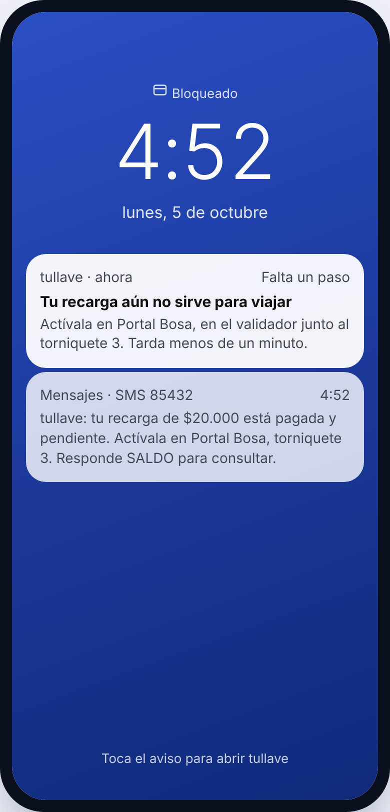

# Listo para viajar

**Cuando pagar no es poder viajar.** Rediseño del ciclo de recarga de la tarjeta tullave en el transporte público de Bogotá.

Proyecto integrador del curso UI/UX para Arquitectos (EFIN-UIUX20265), Maestría en Arquitectura de Software, Universidad de La Sabana, 2026.

**Prototipo navegable:** https://www.figma.com/design/J9s6lRuJMmNvEPS5Fghiui/UX-UI-U-Sabana?node-id=2-3&t=iFyyrGrMKU9PZFF0-1

---

## El problema

Cuando alguien recarga su tarjeta tullave desde el celular, la aplicación muestra "¡Recarga exitosa!". Pero ese dinero todavía no sirve para viajar. El saldo vive en el chip de la tarjeta, así que antes hay que activarlo en un validador o por NFC. La interfaz nunca lo dice con claridad.

El usuario se entera en el peor momento: en el torniquete, en hora pico, con la fila detrás y de tres a ocho segundos para reaccionar.

> "La aplicación me dijo que ya había pagado. Pensé que con eso bastaba." (P1, usuaria frecuente)

En la investigación, los cuatro participantes tomaron la confirmación de pago como el final del proceso.

**Reto de diseño:** ¿Cómo podríamos ayudar a las personas que dependen a diario del transporte público a saber, antes de llegar al torniquete, si el dinero que ya pagaron está realmente disponible para viajar?

## Usuaria y contexto

**Yeimy, 34 años.** Auxiliar de farmacia, vive en Bosa y entra a trabajar a las 6:00 a. m. Tiene poco margen de tiempo, un teléfono de gama de entrada y pocos datos móviles. Los segmentos críticos son los adultos mayores y los usuarios esporádicos.

El problema ocurre entre dos momentos opuestos:

| | Momento 1: la recarga | Momento 2: el ingreso |
|---|---|---|
| Dónde | En casa, desde el celular | En el torniquete |
| Tiempo | Un par de minutos, con calma | De 3 a 8 segundos, de pie y con una mano |
| Entorno | Conexión estable | Ruido, fila y señal intermitente |

## La propuesta

"Listo para viajar" convierte la recarga en una sola experiencia continua, desde el pago hasta el torniquete. Tiene cuatro piezas:

1. **Confirmación en dos estados.** Separa "pago recibido" de "saldo disponible" y dice qué falta.
2. **Estado siempre visible.** Responde de un vistazo "¿puedo viajar ahora?".
3. **Aviso en el trayecto.** Llega cuando todavía se puede actuar, también por SMS.
4. **Ruta "Me rechazaron".** Permite resolver un rechazo en un toque, sin pedir ayuda.

La propuesta se queda en la capa de interfaz y contenido. No toca el backend de recaudo, los validadores ni la política tarifaria.

## Proceso

| Unidad | Entrega | Resultado |
|---|---|---|
| 1 | Brief inicial | Problema, proto persona, contexto y reto de diseño |
| 2 | Investigación | Entrevistas y observación con 4 participantes, 4 hallazgos |
| 3 | Análisis de principios visuales | Comparación entre tullave y Stripe |
| 3 | Tablero de inspiración | 8 referentes (IBM Carbon, GOV.UK, Stripe y 2 en contra) |
| 3 | Arquitectura de información | Navegación por estados, 3 flujos y criterios WCAG 2.2 AA |
| 4 | Prototipo navegable | 14 pantallas, 3 tareas completas, versión 1 y versión 2 |
| 5 | Sustentación final | Evaluación, iteración y trabajo escrito |

## Evaluación de la versión 1

**Métodos:** recorrido cognitivo y revisión heurística del equipo, más una sesión con tres usuarias diarias de TransMilenio (una de ellas adulta mayor) el 4 de octubre de 2026.

**Tareas evaluadas:**

1. Recargar y dejar el saldo listo para viajar.
2. Verificar el estado antes de llegar al torniquete.
3. Recuperarse de un rechazo en el torniquete.

**Métricas:** cumplimiento de los criterios de éxito, toques hasta la solución y severidad de 0 a 4 según Nielsen.

**Resultado principal:** la versión 1 no cumplía el primer criterio de éxito. Repetía el mismo "¡Recarga exitosa!" del sistema actual.

| # | Problema | Severidad |
|---|---|---|
| 1 | "¡Recarga exitosa!" cierra el flujo y la activación queda en una nota gris | 4, crítica |
| 2 | El inicio suma disponible y pendiente en un solo saldo de $20.850 | 4, crítica |
| 3 | "Ayuda" no se asocia con un rechazo y la solución está a tres toques | 3, grave |
| 4 | "Me rechazaron" lista cuatro causas con jerga del operador | 3, grave |
| 5 | El aviso no dice dónde activar ni cuánto tarda | 3, grave |
| 6 | Se pide de nuevo el número de la tarjeta | 2, menor |
| 7 | Paleta ajena a TransMilenio y lectura difícil para personas mayores | 2, menor |

## Antes y después

### 1. La confirmación deja de ser un cierre

| Versión 1 | Versión 2 |
|---|---|
|  |  |

Dos pasos numerados: pago recibido y saldo todavía no, con la hora de activación y una cuenta regresiva. Nielsen 1 y efecto Zeigarnik.

### 2. Un valor nunca aparece sin su estado

| Versión 1 | Versión 2 |
|---|---|
|  |  |

Separa lo que ya sirve para viajar de lo que todavía no, con icono, texto y una acción. WCAG 1.4.1.

### 3. De "Ayuda" a "Me rechazaron"

| Versión 1 | Versión 2 |
|---|---|
|  |  |

Una sola causa probable y la solución a 20 metros. Pasa de tres toques a uno. Nielsen 2 y 9, ley de Hick.

### 4. Un aviso con el que se puede actuar

| Versión 1 | Versión 2 |
|---|---|
|  |  |

Dice dónde activar, en qué torniquete y cuánto tarda, con un SMS espejo para quien no tiene datos. Nielsen 5, WCAG 2.2.1.

**Otros ajustes:** la tarjeta queda asociada al perfil, se usa la paleta de TransMilenio con contraste AA, el texto mínimo es de 16 px y hay opción de "Texto grande".

## Accesibilidad

La versión 2 aplica criterios WCAG 2.2 nivel AA: cada estado usa color, icono y texto (1.4.1), el contraste va de 5,4:1 a 8,2:1 (1.4.3), los botones miden 52 px (2.5.8), la tarjeta no se vuelve a pedir (3.3.7) y los cambios de estado se anuncian al lector de pantalla (4.1.3).

## Aprendizajes, limitaciones y siguientes pasos

**Aprendimos** que el problema no estaba en una pantalla, sino en el silencio entre dos pantallas. Y que hay que desconfiar del propio diseño: la versión 1 repetía el error que criticábamos.

**Limitaciones:** la evaluación fue sobre todo experta, las usuarias eran familiares del equipo, ninguna sesión ocurrió en un torniquete real y el prototipo simula el NFC, el SMS y los tiempos de activación.

**Siguientes pasos:** una prueba formal con cinco participantes de los segmentos críticos en la estación, una validación con lector de pantalla y el mismo distintivo de estado en el validador.

## Equipo

- Andrés Camilo Meneses Ortega
- David Felipe Cifuentes Villa
- David Hernando Monsalve Delima

Profesora: Jenny Constanza Robayo Gómez

## Referencias

- Nielsen, J. (1994). 10 usability heuristics for user interface design. Nielsen Norman Group.
- Nielsen, J. (1994). Severity ratings for usability problems. Nielsen Norman Group.
- W3C. (2023). Web Content Accessibility Guidelines (WCAG) 2.2.
- Yablonski, J. (2020). Laws of UX. O'Reilly Media.
- Frost, B. (2016). Atomic design.
- Wharton, C., Rieman, J., Lewis, C., y Polson, P. (1994). The cognitive walkthrough method: A practitioner's guide.
